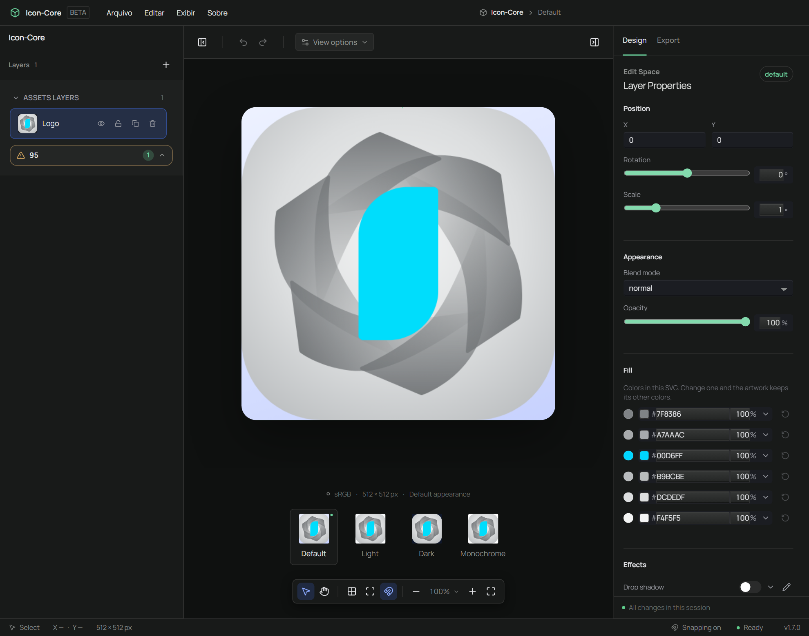
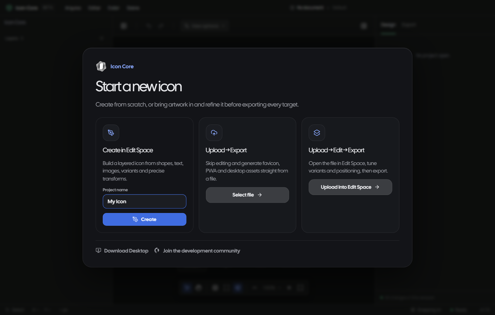
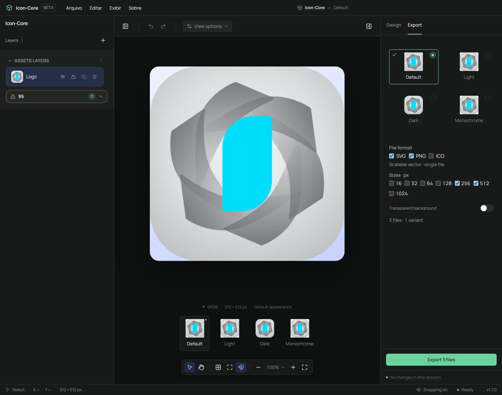
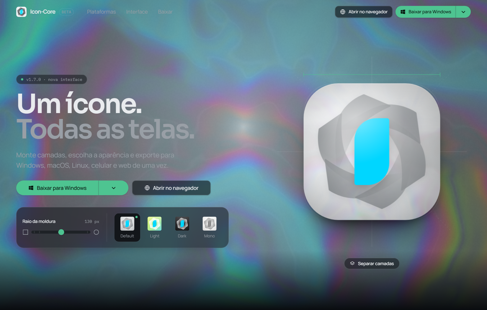

# Icon Core

[English](README.md) | [Português (Brasil)](README.pt-BR.md) | [Español](README.es-ES.md)

Free, open-source app icons, from first sketch to finished files. Design in the browser or on the desktop. Everything runs on your machine. No account, no uploads, no server.



## Start your way

Three doors, same exit: finished icon files.

### Start from scratch



Open Edit Space on a blank canvas. Add shapes, text and images as layers, tune each one, and preview light, dark and mono variants as you go.

### Start from a file

Skip the canvas. Drop in a finished SVG, PNG, JPG or WebP and go straight to export.

### Start from a file, then refine

Open your file in Edit Space first, adjust positioning and variants, then export.

## Export from the Inspector



Export is a tab in the Inspector, beside Design. Choose the variants, the formats (SVG, PNG, ICO), the PNG sizes you need and whether the canvas background goes transparent; the panel counts the files before writing them. **Export** downloads them, and **Download all (.zip)** packs the result into one archive. The preview uses the same engine as the export, so the file matches what you saw.

## Try it

- Web app: https://mafhper.github.io/icon-core/app/
- Landing page: https://mafhper.github.io/icon-core/
- Desktop releases: https://github.com/mafhper/icon-core/releases
- Repository: https://github.com/mafhper/icon-core

[](https://mafhper.github.io/icon-core/)

## What it does

- Layers for shapes, text, images and SVG, with position, size, rotation, opacity, color, gradients, blend and shadow — plus hue, saturation, brightness and contrast on image and SVG layers
- Light, dark and mono previews as live tiles beside the canvas, with an optional safe-area guide
- One export surface for SVG, PNG (16 to 1024 px) and multi-size ICO, with the variants you pick
- Every layer adjustment survives the SVG export, not just the PNG
- The exported frame follows the canvas shape, while container formats such as ICO stay full bleed because each platform applies its own mask
- Projects autosave in the browser; nothing is uploaded

## Development

Prerequisites:

- Node.js 22+ (npm)
- Rust toolchain for desktop builds

```bash
npm install
npm run dev:web     # browser app on :5173
npm run dev:promo   # landing page on :5174
npm run build       # everything for GitHub Pages
```

```bash
npm audit --audit-level=high
npm run lint
node scripts/check-third-party-assets.mjs
node scripts/check-ui-boundary.mjs
node scripts/check-ui-budget.mjs
node scripts/check-ui-contrast.mjs
npm run typecheck
npm run test
```

CI also runs `npm run build`, the Playwright e2e suite against the landing page
(`npm run test:e2e`) and the visual contract capture (`npm run ui:shots`). The
`scripts/check-*.mjs` guards are cheap and catch what lint cannot.

The README screenshots come from `scripts/capture-screenshots.mjs`, which drives
both dev servers and writes to `docs/assets/`; re-run it instead of editing images
by hand.

Generate the desktop bundles:

```bash
npm run build:desktop
```

## Repository

```text
apps/
  promo/      Public landing page
  web/        Browser app
  desktop/    Tauri desktop shell
packages/
  iconcore-shared/     Shared project types
  iconcore-renderer/   Canvas/SVG rendering
  iconcore-exporters/  Asset targets and ZIP inputs
  iconcore-engine/     Planning and schema utilities
  iconcore-validator/  Project validation
  iconcore-cli/        Command-line tools
  iconcore-ui/        Design system primitives
```

## Contributing

Issues, fixes and experiments are welcome. Keep changes focused, run the relevant checks, and include validation notes in pull requests.

## License

MIT License. See [LICENSE](LICENSE).
